# Galaxia Coresi – Django Web Application

### Educational Project | Link Academy

## About the Project

Galaxia Coresi is an educational web development project created during my Python and web development training at Link Academy.

The project explores building a website focused on Romanian literature, books, publishing, and cultural activities using Python and the Django framework.

It represents part of my practical learning experience in web development.

## Technologies Used

- Python
- Django
- HTML5
- CSS3
- SQLite
- Git & GitHub
- Visual Studio Code

## Project Structure

- `accounts/` – Account-related Django application
- `core/` – Main website application
- `core/templates/` – HTML page templates
- `users/` – User-related Django application
- `coresigalaxia_project/` – Main Django configuration
- `manage.py` – Django management script

## Project Content

The project includes page templates for:

- Book and literature presentations
- Publishing and manuscript-related information
- Educational and cultural activities
- Contact forms
- User registration and login
- Reading and literary resources

Some features may require further development or testing.

## Running the Project Locally

1. Install Python and create a virtual environment.
2. Install Django and python-dotenv.
3. Create a `.env` file containing a new Django secret key and local development settings.
4. Apply database migrations if needed.
5. Start the development server:

    python manage.py runserver

6. Open `http://127.0.0.1:8000/` in your browser.

Note: Private credentials, the local database, and certain image assets are intentionally excluded from this repository.

## What I Learned

This project helped me gain practical experience with:

- Organizing a Django web application
- Working with Python project files
- Understanding templates and website structure
- Running and testing a local development server
- Managing configuration and environment variables
- Using Git and GitHub for version control

## About Me

I am a Computer Science student at the European Higher Education Institute (EHEI), Malta.

I am interested in software development, cybersecurity, software testing, and digital technologies.

I am continuing to develop my programming skills through university studies, online courses, and practical projects.

## Project Status

Educational project – ongoing learning and improvement.

## Author

Anamaria Poenaru

Computer Science Student

GitHub: [marjaaa2](https://github.com/marjaaa2)

---

---

## Project Screenshots

Below are screenshots of the Galaxia Coresi educational Django web application, developed during my training at Link Academy.

### 1. Homepage
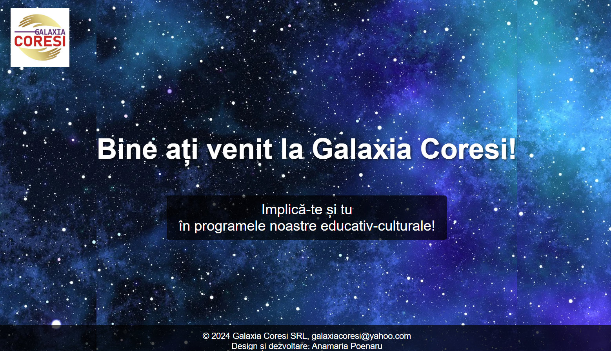

### 2. Educational & Cultural Projects
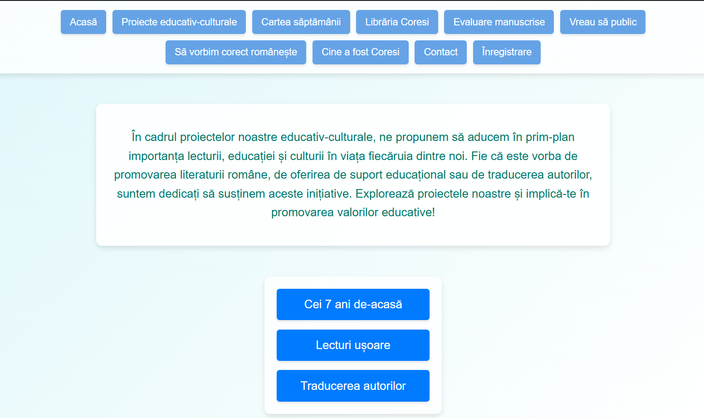

### 3. Book of the Week
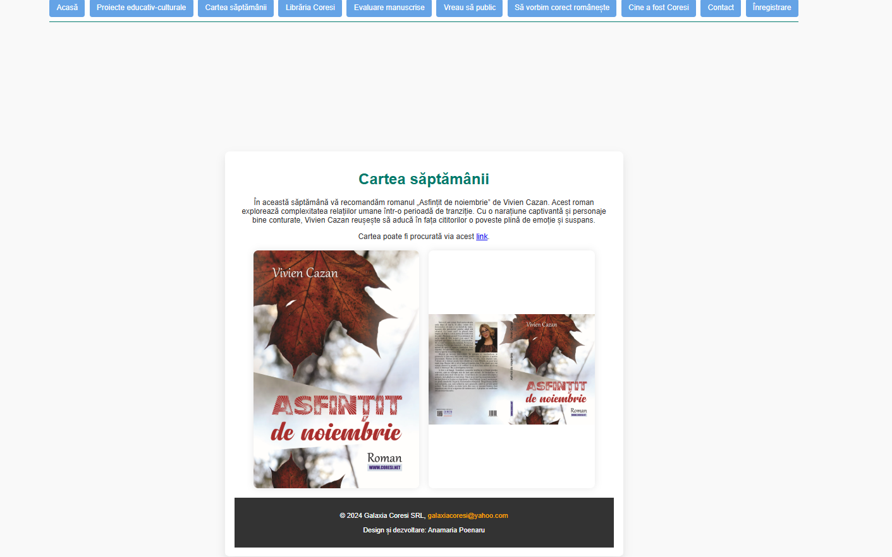

### 4. Publishing Information
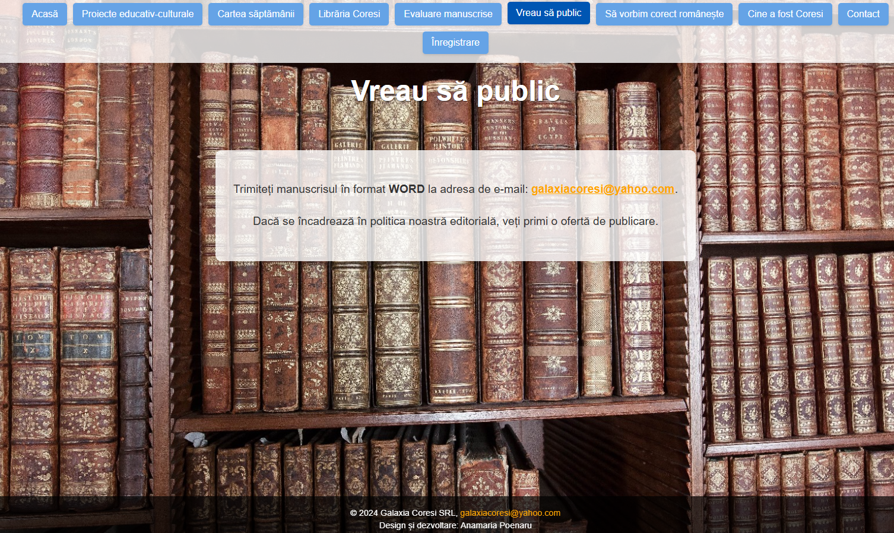

### 5. Reading Benefits
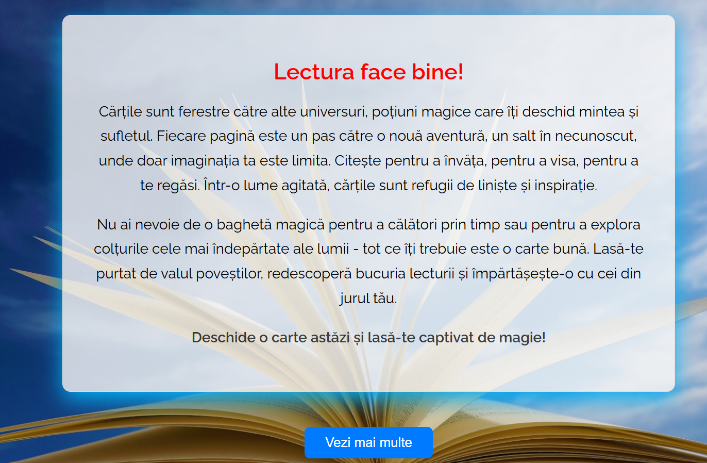

### 6. Library Navigation
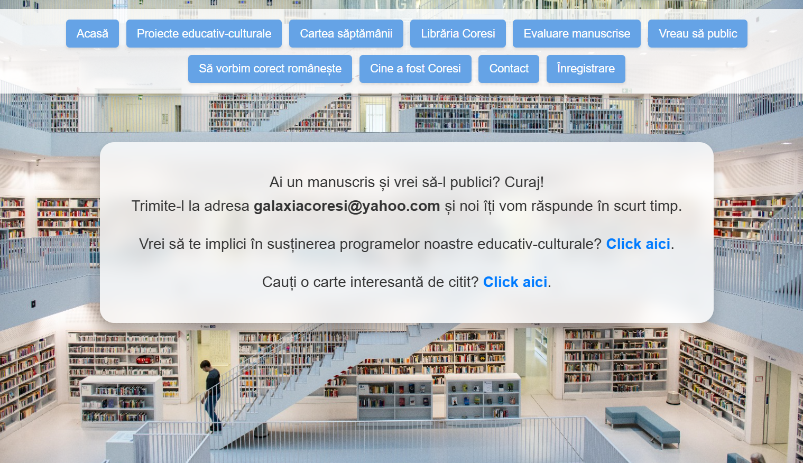

### 7. Manuscript Evaluation
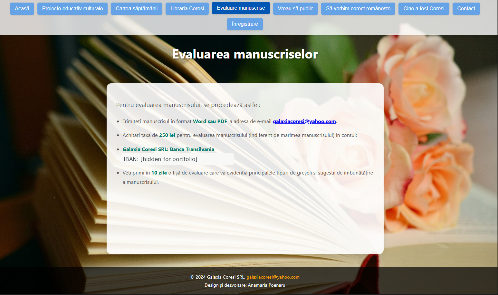

### 8. Romanian Language Resources
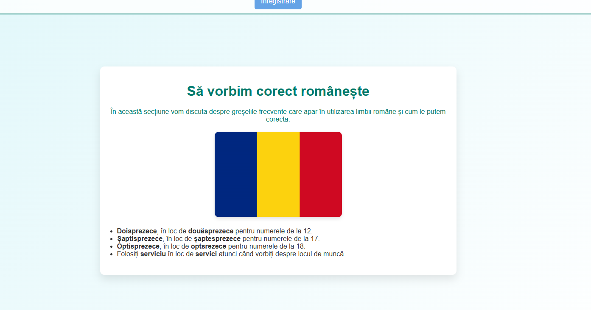

### 9. History of Coresi
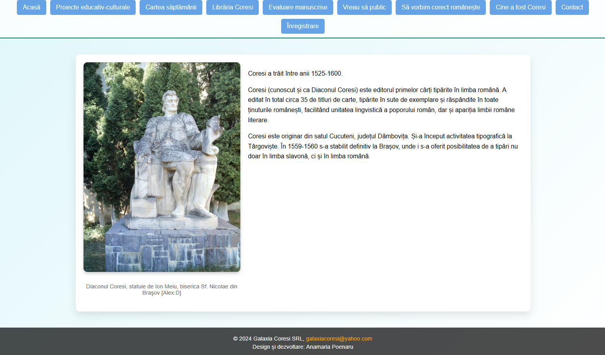

### 10. User Registration
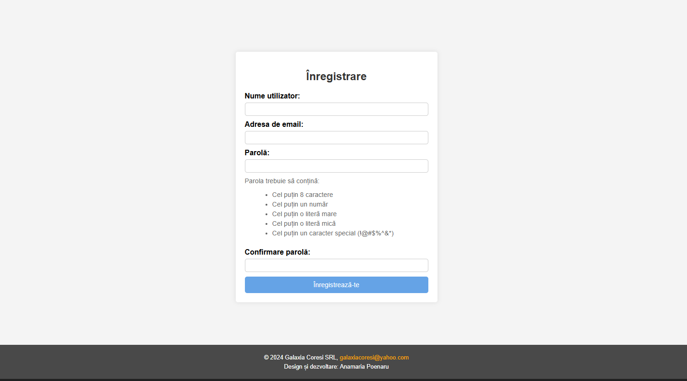

---

## External Website Integration – ePublishers

The Galaxia Coresi educational website includes links to the ePublishers online bookstore.

These links allow visitors to explore books, discover recent publications, and access additional publishing-related resources.

The ePublishers website is a separate external platform and is not part of the Django application's source code.

### 11. ePublishers Homepage
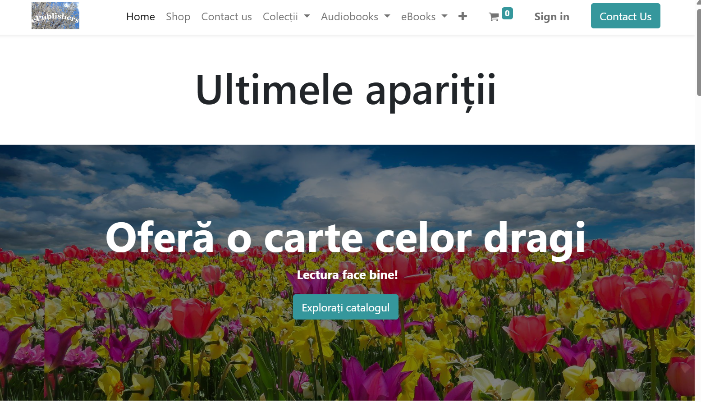

### 12. ePublishers Book Catalog
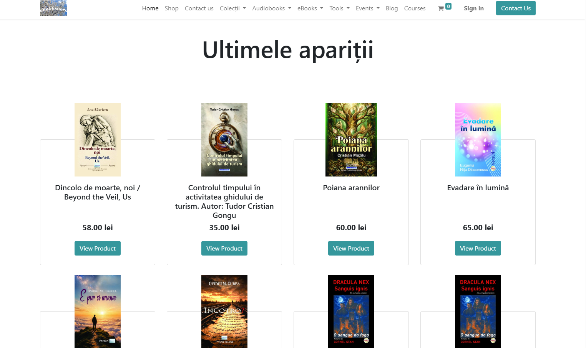

### 13. ePublishers Recent Sales
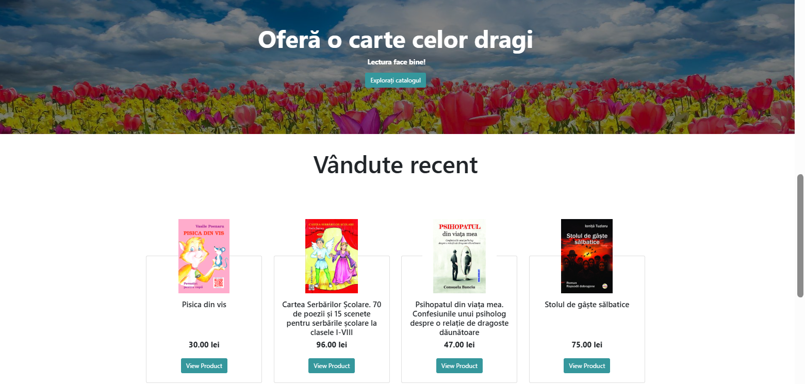

### 14. ePublishers Publishing Information
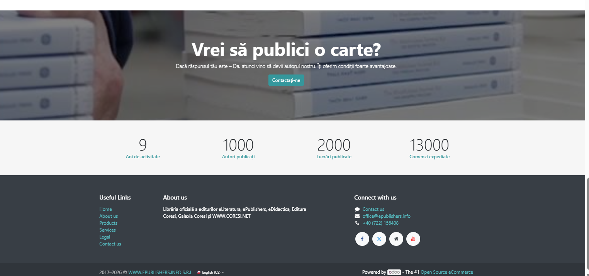

---

## Project Development

This project helped me gain practical experience with Python, Django, HTML, CSS, website structure, templates, navigation, and version control using Git and GitHub.

The application is part of my ongoing learning journey in software development and web technologies.

**Developed by:** Anamaria Poenaru  
**Training:** Link Academy  
**Project type:** Educational Django Web Application
